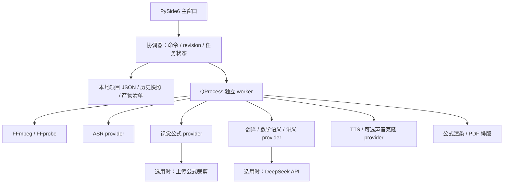

# 课译 TransLesson 完整设计

## 1. 推荐形态

一个 Windows 11 优先的小桌面应用，Python + PySide6 Widgets 实现。用户把视频放进项目，经过自动分析、重点校对、试听，导出翻译视频、字幕和课程讲义。窗口不承担模型计算，模型按需加载；不部署账号系统、SaaS 后端或常驻服务器。

按用户追加要求，提供两种处理配置：

- **推荐混合模式**：媒体、ASR、关键帧采样、工程数据、配音排布与导出在本地；DeepSeek Flash API 承担数学口语解析、术语提取、翻译和讲义整理。视觉疑难可选上传局部公式截图。这样可减少本地语言模型安装和内存压力。
- **完全离线模式**：事先安装模型后，文本任务改用 llama.cpp + Qwen3-4B 量化模型，公式视觉识别用 Pix2Text，普通配音用系统声音。该组合是资源起点，数学效果必须通过相同测试集验证。高级音色克隆另装增强包。

“混合”不会改变桌面产品形态，只是其中部分模型运行在外部 API。用户可以按阶段选择 provider；失效时不静默更换数据去向。具体 API 路由、成本与验证见 [API 方案](07-api-strategy.md)。

框架选择以开发难度优先：Python 可直接衔接多数音视频/模型工具。Tauri 的壳更小、网页公式编辑更方便，但当前项目会同时引入 Rust、TypeScript 与 Python sidecar，先不采用。Qt 的数学显示使用预渲染 SVG/PNG，避免首版引入 Chromium/WebEngine。

## 2. 模块架构



协调器是项目唯一写入者。UI 发编辑命令，worker 只生成带输入revision的临时产物，协调器验证后接纳。项目以小型 JSON 与不可变 revision 快照保存，原始模型结果、用户校正和缓存分开；首版不加 SQLite。若未来大量逐词编辑导致 JSON 性能瓶颈，再依据接口迁移。

主线程只处理 UI 和播放器。推理、hash计算、文件读写、下载、FFmpeg均在独立工作进程。重模型默认串行，完成阶段后卸载，避免 ASR、视觉、语言模型与声音模型同时占满内存。worker 崩溃后界面仍能保存校对内容。

llama.cpp 离线文本模式如使用本地 HTTP，只在任务期间绑定 `127.0.0.1`，由应用启动与回收，不作为常驻网络服务。其他接口走文件与 JSONL，不引入消息队列、Redis、Docker 或分布式任务系统。

## 3. 选型与资源边界

| 环节 | 首版默认 / 增强选项 | 决策 |
|---|---|---|
| 桌面 | PySide6 Widgets + QtMultimedia | 字幕表格、播放器、文件操作用原生窗口 |
| 媒体 | FFmpeg / FFprobe sidecar | 单一工具链承担抽轨、时间对齐、混音与编码 |
| 语音识别 | faster-whisper 多语种 small，CPU int8 | 先验证中文/英文数学口述；不能使用仅英语的 `.en` 权重 |
| 高配识别 | 同 provider 的 large-v3，受测NVIDIA配置 | 选择兼容的 CTranslate2/CUDA/cuDNN，不能仅检测显卡存在 |
| 文本与语义 | 混合模式 DeepSeek Flash；离线 Qwen3-4B + llama.cpp | 同一结构化输出协议，模型版本进入缓存 |
| 视觉公式 | Pix2Text 精简检测/公式识别 + 必要中英OCR | 不默认加载整页表格和复杂文档布局模型 |
| 普通配音 | Windows 可用的已安装目标语言声音 | 启动前检查声音是否可枚举、可输出WAV；这是固定声音 |
| 原音色增强 | 本地 CosyVoice3 独立环境，或可选 ElevenLabs Instant API | 中英跨语言样片与 Windows 运行通过后才列为可发布能力 |
| 背景分离 | 原有独立音轨优先；可选固定版本 Demucs | 音乐分离器不保证课堂环境声分离效果，上游已归档 |
| 公式 / PDF | 本地 MathJax Node helper + QtSvg + ReportLab | 一套公式源，分别生成 UI/视频图片与讲义PDF |
| 数据 | JSON、历史快照、文件缓存 | 单任务、单写入者；无需数据库服务 |

首个受测平台为 Windows 11 x64；其他平台不列为已支持。CPU 测试起点为16 GB RAM，不承诺8 GB电脑或实时性能。GPU为可选加速，不是启动条件。安装体积拆成基础程序、ASR/视觉模型、离线语言模型、音色增强包；各自显示真实下载大小，不能将UI体积当成总安装体积。

代码、权重、字体、FFmpeg 二进制分别记录来源和许可。PySide6/Qt、FFmpeg 编译组件和字体的分发条件不同；发布包附实际使用版本的第三方清单。选型依据见 [来源记录](06-sources.md)，尚未做安装和性能验证。

## 4. 自动处理流水线


处理不是把整个视频丢给一个“大agent”。程序控制时间轴和文件；模型只对有限证据给出结构化内容。自动运行能先生成所有草稿，界面聚焦高风险片段；最终导出基于校对后的固定revision。

### 4.1 探测、提取与转写

FFprobe 记录容器、轨道、起始PTS、旋转、VFR、分辨率和可解码性。ASR用16kHz单声道PCM，混音保留高质量原采样音频。VAD裁切和重采样都必须映射回视频零点，不能丢掉静音后让字幕整体前移。语义配音段约3–15秒只是初始分段策略，字幕cue再拆成可读长度。

明确选择源语言，自动检测作为建议；不要使用“直接语音翻译成英语”代替中英双向转写流程。保留逐词原结果与源句。漏掉否定词、量词、正负号等，优先回查音频或重识别，LLM不能凭空恢复证据。

### 4.2 视觉公式

每2秒的低清缩略帧只做变化检测，检测到课件切换/板书变化后取原分辨率稳定帧；连续板书每10秒兜底。用户可框选黑板区域，避免把老师、人脸和播放器控件送OCR。对检测框裁剪后识别，保留原帧PTS、bbox和图片hash。

采样属于成本启发式，短暂闪过的公式仍可能漏检。校对页支持“识别当前帧”和手动框选。遮挡、低清、复杂手写无法确定时保留截图，标记待校对；不会生成看似完整的替代式。

### 4.3 数学语义与术语

从整课转写及视觉证据提取术语，初始化课程词表，然后按语义句翻译。锁定译法结合概念上下文，而不是全局字符串替换。翻译时把公式作为受保护ID传递；变量、数字、条件、否定词、积分上下限是后验检查重点。

公式采用“原表达 + 候选LaTeX + 两种语言读法 + 来源”四部分。`x squared...` 可识别为多项式，`e的x次方`可识别为指数；`one over x plus one`必须考虑分母范围。`对x求偏导`没有对象时不能补出不存在的函数。ASR和OCR冲突、手写、上下标、偏导/全导数、矩阵维度进入重点复核。

MathJax能排版只说明语法可渲染；API输出高分、回译一致或两个模型同意，都不能单独证明数学正确。复杂式需要原画面/原音并排确认。允许保留未识别原图，并在学习材料中标注。

## 5. 字幕与配音

### 5.1 三种文本

| 用途 | 表达示例 |
|---|---|
| 数学主数据 | `x^2 + 2x + 1`，可追溯的公式ID |
| 普通字幕 | `考虑多项式 x² + 2x + 1。` |
| 目标语言配音 | `考虑这个多项式，x 的平方加二 x 加一。` |

SRT/VTT 输出纯文本和Unicode简式，不写入裸LaTeX期待播放器自动渲染。分式、矩阵等完整公式在讲义中排版；可选“公式烧录”先生成透明PNG再按时间叠加视频。ASS负责字体、颜色、位置，也不能原生解释LaTeX。

一条配音语义段可拆多条字幕cue；字幕断行不改变配音。初始两行上限，中文16–20字/行、英文约36–42字符/行仅作为可调提示，读速需用教学样片校准。字幕支持顶/底位置及短片预览，避免盖住板书。

### 5.2 音色与试听

提供“标准声音”和“参考老师声音”两种模式。后者需要当前provider支持跨语言参考合成，并由用户确认声音使用权限。建议从视频中选10–30秒干净单人片段，由具体模型能力限制验证；这不是所有模型通用的参考时长。

先自动准备包含普通讲解、术语和公式的约30秒试听，显示文案revision。用户可换参考片段、调语速、A/B试听原声与译声。更改文本后旧预览必须标为过期。

完整功能版至少要有一条经过中→英、英→中试听验证的音色相似路径。普通TTS闭环只能作为基础版本，不能据此宣称已完成原老师音色要求。本地克隆Windows适配若失败，可以用用户选定的API路径；离线用户仍有明确的标准声音选项。

### 5.3 保留原时间轴

视频画面和总时长默认不改变。TTS实际时长D与窗口T比较，用模型语速和原有停顿先调整；再在保证数学条件和术语完整的前提下提议精简读法，用户可审阅。轻度atempo建议初始限定0.90–1.15，需试听验证。

仍放不下则标记 `TTS_TOO_LONG`，让用户调整译文、分段或语速，不能截尾、吞字、覆盖下一段。原视频扩展停顿、口型同步均不属于首版。配音排布在统一采样率的整条PCM时间线上，最终一次编码，避免累计漂移。

## 6. 背景声、合成与导出

有独立背景轨时直接复用。只有混合轨时可启用分离，将残差当背景候选，并在含背景片段试听；Demucs主要面向音乐，老师人声可能残留，敲黑板声也可能被破坏。

分离失败时明确选择：只用译声、低音量原声的双语旁白、或保留原声只加字幕。后三者的名称和导出清单必须反映真实策略，不能标记为已保留干净背景声。不会直接把完整原人声轨称作背景混回去。

导出设置：MP4视频、独立SRT/VTT、PDF讲义默认勾选，可选WAV、ASS、Markdown与公式JSON。无烧录且容器兼容时复制视频流；烧录字幕/公式需重编码。音量归一化、必要限幅，原音与译音先转为相同声道与采样率。

先导出30秒预览检查板书遮挡、公式字号、音量、时长。全片临时输出完成后用FFprobe验证音视频轨和时长，检查无缺段、无失效引用，再原子提交到目标文件。完成前不把临时MP4展示为成功。

## 7. 课程讲义与PDF

讲义不是字幕拼接。默认结构：课程信息与校对状态、学习目标（仅材料支持时）、章节概念、定义与公式、原课推导步骤、例题、课程术语表、来源时间索引。原课没讲出的结果不自动补齐；不默认生成新证明或习题答案。

先形成证据表，再由模型整理结构化讲义。每个核心定义/公式/命题引用已存在的语音段或视觉公式证据，界面可跳回课程片段。检查引用存在只是第一层，仍要逐条检查关键数学内容是否受来源支持。首版不启用AI补充解释；未来开放时必须单独标注。

PDF使用本地MathJax把支持的LaTeX数学子集渲染成独立SVG，所需数学字体/组件随helper提供并关闭外部加载，采用不依赖全局字体缓存的独立glyph路径；QtSvg按最终物理尺寸栅格化为300dpi公式图，ReportLab Platypus负责分页。保存SVG和LaTeX源便于后续重排。这是工程取舍：避免另装完整TeX/Chromium，首版公式在PDF中为图片，不能承诺公式文本可搜索或矢量缩放无限清晰。

A4正文11–12pt、嵌入受测的静态中文TTF、CJK换行。公式不跨页拆开，超宽公式先受控分行再预览；过高矩阵独立页，不能无限缩小。标题与下一段保持，页码和来源时间可见。导出后逐页渲染检查乱码、重叠、裁切与空白异常。

## 8. 窗口设计

```text
┌ 课译 TransLesson    项目：微积分01     已保存 revision 7 ─────────────┐
│ 导入 │ 校对 │ 配音 │ 讲义 │ 导出              本地 / 混合 API       │
├───────────────────┬──────────────────────┬─────────────────────────┤
│ 视频预览          │ 时间     原文 / 译文  │ 本段公式                │
│ [播放] [原声/译声]│ 00:12.1  Consider... │ x² + 2x + 1             │
│                   │          考虑……      │ [LaTeX编辑] [原图]      │
│ 当前关键帧        │ 00:16.4  Next...     │                         │
│ [框选并识别]      │          接下来……    │ 术语 derivative → 导数  │
│                   │ [全部 / 待确认]       │ [锁定] [确认]           │
├───────────────────┴──────────────────────┴─────────────────────────┤
│ 当前：翻译 28/93段     待确认：4     API费用：已用 / 预算    [停止]  │
└───────────────────────────────────────────────────────────────────┘
```

导入页有源/目标语言、输出目录、provider配置、模型状态。点击一次开始即可自动处理草稿；数据上传范围按项目设置一次确认，不逐句弹窗。模型缺失时显示真实大小与下载/本地导入选项。

校对页支持改源文/译文、拆并段、时间、公式、词表、撤销与确认。任务结果只能写回匹配的旧revision，不能覆盖刚编辑的新内容。讲义可按章节改写；导出页固定快照并列出待处理问题。

进度显示当前阶段及“28/93段”或“17/42帧”。不知总量时用忙碌指示；总百分比若采用阶段权重，只能标为估计。取消有“当前模型调用完成后停止”状态；崩溃重开从已验证checkpoint继续。支持重试失败阶段，无需重跑整课。

## 9. 隐私、成本与数据安全

应用默认不对外发送课程数据；首次选混合配置时保存允许的文本/截图/参考声音范围。外部API只收到当前任务所需材料，不上传整个视频。API key存Windows凭据库；项目、Git和日志均不保存密钥。

本地模式运行时禁止provider隐式下载或调用外网，模型下载单独操作。媒体内容和模型输出视为数据，不能指挥agent执行shell、读任意文件或改设置。外部模型没有任意工具权限；所有来源ID、路径和结构验证在本地完成。

MathJax只开放受限数学语法与扩展，禁止模型任意require/autoload、外部URL和执行命令；限制公式长度、宏展开、渲染时间与输出尺寸。正文转义后进入排版器，生成的SVG不允许脚本或远程资源。缓存清理入口保留用户修订和最终导出。

## 10. 首版交付判断

先用1–2分钟中英数学片段打通闭环，再用10分钟基准、最后用30–60分钟长课验证资源与恢复。基础版需要字幕、标准配音、视觉公式候选、讲义PDF全部贯通；完整需求还需已验证的相似音色provider及背景声策略。

不会因为“API返回成功”“公式渲染成功”或“所有页面做好”就宣布完成。实际门槛、样本和异常路径见 [验收标准](05-acceptance.md)，实现分工见 [交付计划](04-delivery-plan.md)。
